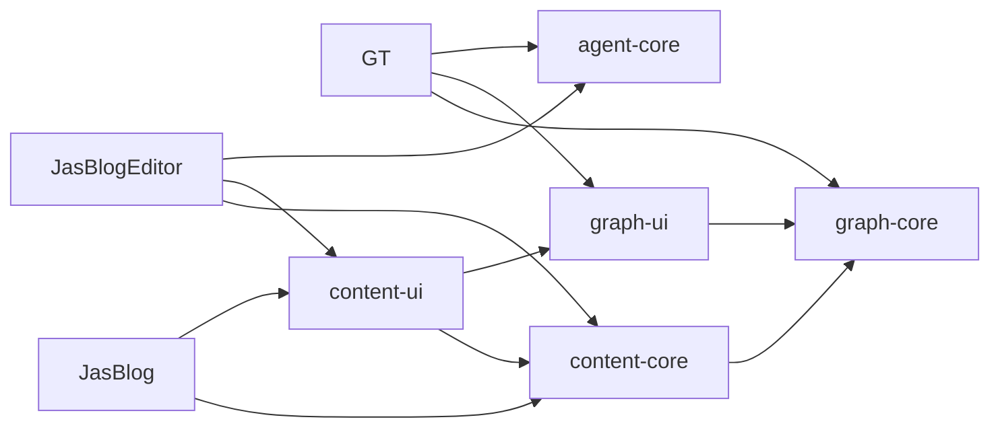

# 模块归属与执行边界

三个应用独立构建和发布。公共代码只通过固定版本包使用，应用不读取其他仓库的源码、样式或运行状态。

| 模块 | 唯一职责 | 不允许依赖 |
| --- | --- | --- |
| graph-core | 图谱类型、结构校验、序列化、显式旧数据迁移 | React、DOM、文件系统和应用配置 |
| content-core | YAML、正文、日期、日记、规划、锚点、路径身份和写作示例 | React、Next、Tauri 和应用状态 |
| graph-ui | 图谱只读展示、节点卡片和 HTML 清理 | 应用状态、持久化和导航实现 |
| content-ui | 正文、目录、图片、图表、详情和列表展示 | Next、Tauri、工作区文件读取和应用状态 |
| agent-core | 协议、状态转换、投影、输入校验、串行命令、去重和恢复 | 图谱业务、文档业务和具体存储 |



## 宿主职责

博客持有路由、metadata、静态导出和 Node 文件读取。编辑器持有工作区、编辑态、列表读取缓存、LLM 传输和 Tauri 文件命令。GT 持有编辑交互、图谱算法、Profile、Adapter、领域工具合同和图谱持久化。

ContentHostProvider 注入导航、图片、滚动容器和主题。展示层只接收数据与回调。图谱和 Mermaid 按实际内容动态加载。样式从显式导出加载，正文和图谱分别限制在 `.jas-content` 和 `.jas-graph` 内。

本次不新增远程微服务。博客是静态站点，两个编辑器需要本地文件访问和离线工作；远程服务会增加部署、网络和数据同步成本，当前业务没有独立运行该服务的要求。

## Agent 执行

每个应用建立自己的 tracker 和命令队列。Zustand 只订阅投影，不再维护另一份状态机。时间统一为 Unix 毫秒，actor 使用固定角色，actorId 保留具体调用者标识。

命令按照提交顺序串行执行。执行前保存请求 ID 与输入摘要，完成后保存结果。相同 ID 和输入读取已有结果；相同 ID 对应不同输入返回冲突。恢复时不重放未完成请求，展示 OUTCOME_UNKNOWN。暂存中的审批被保留，接管会使待处理审批失效。

保留最近 100 个已完成请求的完整结果，较旧结果归档后仍保留请求身份并阻止重放。会话、任务和事件历史限制展示数量，未结束记录始终保留。

GT 的 Rust 只负责 loopback HTTP 鉴权、协议检查、请求转发、SSE 通知和文件访问。图谱与 Agent 状态只存在于 TypeScript 执行端。界面未初始化返回 APP_UNAVAILABLE；断开或超时返回 OUTCOME_UNKNOWN，不切换到其他执行实现。SSE 不携带图谱镜像。文件通过临时文件、同步与原子替换写入，令牌来自系统随机源。

GT 的导出审批绑定图谱内容及选区。编辑器的删除审批绑定磁盘和草稿版本，真正删除前再次检查；只允许删除当前工作区内的普通文件。保存期间发生的新编辑继续保留为未保存草稿。

## 数据迁移

应用直接读取完整 v1 图谱，错误时停止自动保存。旧数据使用显式迁移命令：

```sh
node scripts/migrate-graphs.mjs /path/to/graph.json --report /path/to/report.json
node scripts/migrate-graphs.mjs /path/to/content --apply --report /path/to/applied.json
```

默认只检查。`--apply` 为每个变化文件创建独立备份，保留 BOM、换行、代码块外正文、YAML 注释和未知字段。重复 ID、悬空边、坏 JSON 等无法无损处理的输入直接报错。目录迁移逐文件保存结果，中断后可使用同一输入重新运行，已升级文件无需重写。

旧 Agent 审计文件保留只读，新检查点与事件使用 v1 文件，不隐式改写旧日志。

## 发布和更新

`npm run build -- graph-ui` 构建指定包及它依赖的公共包。完整验证使用 `npm run build`、`npm test`、`npm run check:boundaries`。CSS 引用的字体必须随安装包存在，并保留 KaTeX 的许可文件。

`npm run pack` 生成固定 Release URL 的安装包，标签格式为 `<package>-v<version>`。包内依赖、应用依赖与 lockfile 都固定版本。应用更新独立进行；不通过工作区软链接或跨仓库别名获取开发中的公共源码。

发布前检查真实压缩包，再从工作区外复制应用源码执行 npm ci、测试和构建。公开仓库不包含用户创作内容、应用数据、凭据和构建产物。
